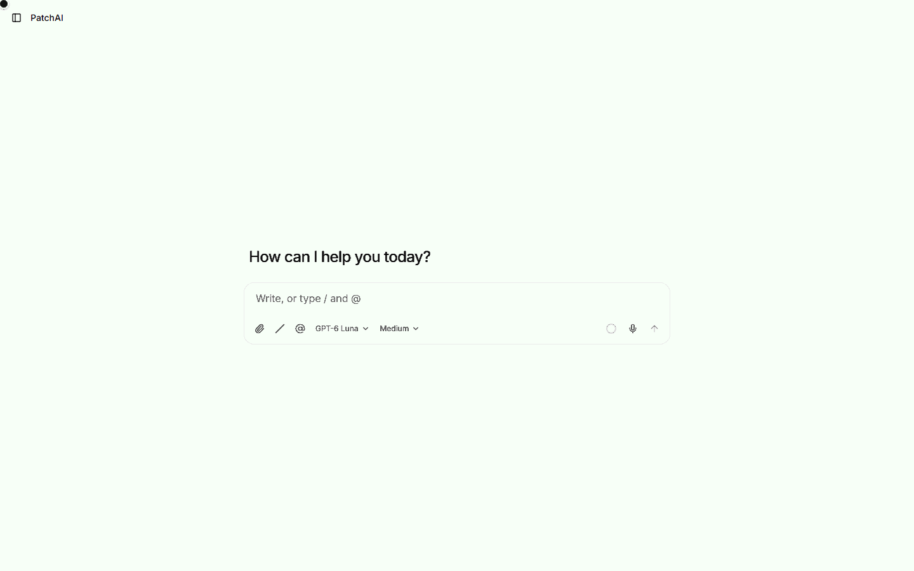
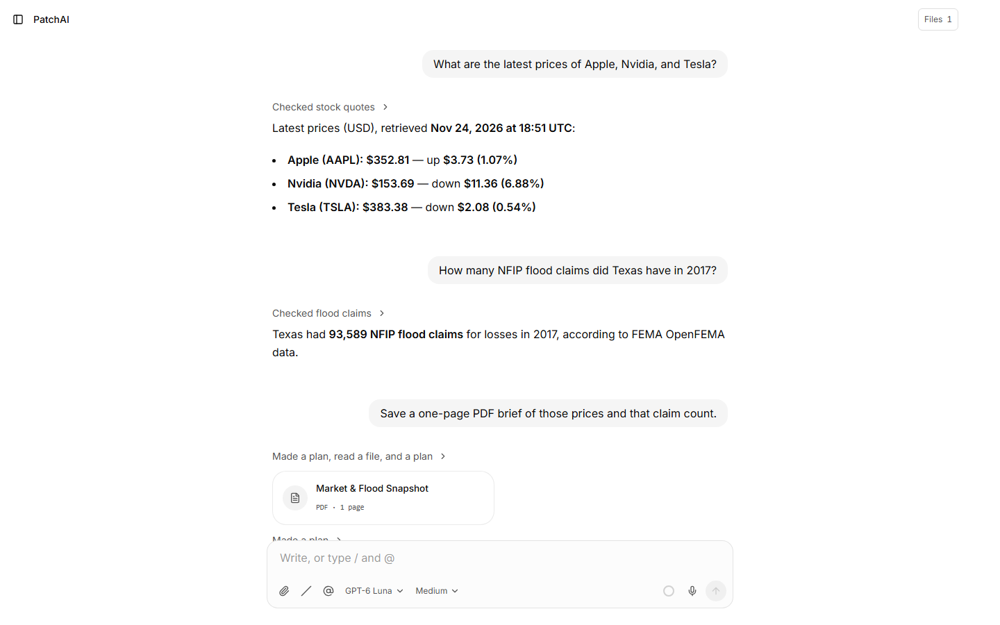
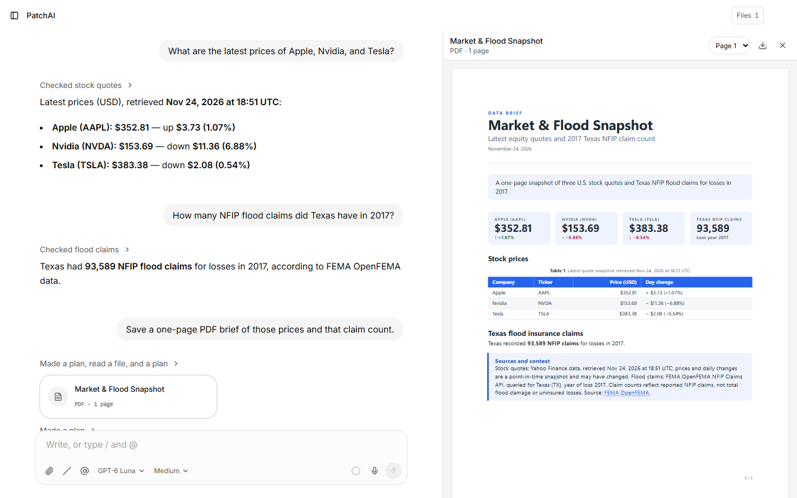
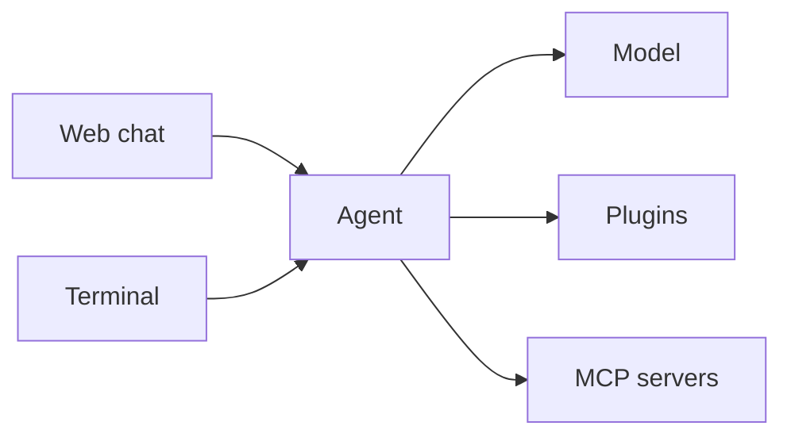

<div align="center">

# PatchAI

A local chatbot for quotes, claims, briefs, and reports. A [Deep Agents](https://github.com/langchain-ai/deepagents) harness answers each turn. A channel carries the message, and the harness never talks to the browser or the terminal itself.

[](LICENSE)
[](https://www.python.org/downloads/)



</div>

The web chat is at <http://localhost:3000>. The agent listens at <http://127.0.0.1:8765>. The same process can answer in the terminal.

## Contents

- [What it can do](#what-it-can-do)
- [Quick start](#quick-start)
- [A thread](#a-thread)
- [Terminal](#terminal)
- [Configuration](#configuration)
- [How it works](#how-it-works)
- [Where things live](#where-things-live)
- [Plugins](#plugins)
- [Tests](#tests)
- [License](#license)

## What it can do

- Stream a reply, and pick a model and a reasoning effort in the composer.
- Open an interactive report beside the thread, with text, figures, tables, charts, and diagrams. A control in the report updates the figures without another model call.
- Create and revise a PDF, a PowerPoint, or a Markdown file. Files land in `exports/`, and the thread shows a card for each one.
- List what this thread holds. Output is what the assistant made. Input is what you attached.
- Answer the time, look up US flood-insurance claims, and call the servers in `mcp.json`.

## Quick start

You need Python 3.11 or newer, Node.js 22, and an API key for the model. The default model is `openai:gpt-6-luna`. PDF, PowerPoint, and Markdown are on in `config.toml`, so the matching extras are part of a normal install. Interactive reports also need the Node packages in `web/`.

From the repository root:

```bash
python -m venv .venv
```

Windows:

```powershell
.\.venv\Scripts\Activate.ps1
pip install -e ".[pdf,pptx,md]"
copy .env.example .env
```

macOS and Linux:

```bash
source .venv/bin/activate
pip install -e ".[pdf,pptx,md]"
cp .env.example .env
```

Put your key in `.env`. The file is gitignored.

```text
OPENAI_API_KEY=
PATCHAI_MODEL=openai:gpt-6-luna
```

`PATCHAI_MODEL` overrides `[model].name` in `config.toml`. Leave it unset to use the file.

Start the agent from the repository root, then the page from `web/`. Use two terminals.

```bash
python -m patchai
```

```bash
cd web
npm install
npm run dev
```

Open <http://localhost:3000>. The page posts each turn to `http://127.0.0.1:8765/chat`. Set `PATCHAI_URL` in the web process if the agent listens somewhere else.

## A thread

Three turns from a live conversation:

```text
What are the latest prices of Apple, Nvidia, and Tesla?
```

```text
How many NFIP flood claims did Texas have in 2017?
```

```text
Save a one-page PDF brief of those prices and that claim count.
```

<p align="center">
  
</p>

The brief opens beside the chat:

<p align="center">
  
</p>

## Terminal

Set the channel, then start the same process:

```toml
[channel]
active = "cli"
```

```bash
python -m patchai
```

Each line is one turn. A blank line ends the session. The CLI prints the finished reply. The browser is what draws reports, PDFs, decks, and Markdown files.

## Configuration

`config.toml` chooses the channel, the model, the plugins, and the MCP file.

```toml
[channel]
active = "web"

[model]
name = "openai:gpt-6-luna"

[plugins]
enabled = ["example_clock", "openfema_flood", "pdf_report", "pptx_deck", "markdown_doc", "report"]

[mcp]
config = "mcp.json"
```

`[model.options.openai]` is passed through to the chat model. The page can still switch among the chat models and efforts for a single turn.

`mcp.json` lists MCP servers. A server that cannot be reached is skipped. The plugins still load. The file shipped here starts [open-market-data](https://github.com/anotb/open-market-data) and [Boleron](https://boleron.eu/en/for-agents/).

## How it works



The web page and the terminal are channels. Each one hands the turn to the same harness. Plugins and MCP servers add tools. Skills in `skills/` tell the agent how to use them. The page keeps the visible thread and sends it again with the next message.

## Where things live

| Path | Role |
| --- | --- |
| `src/patchai/` | The agent, channels, and plugins |
| `web/` | The Next.js chat |
| `skills/` | Procedures the agent reads when a task needs them |
| `memory/AGENTS.md` | Standing instructions for the agent |
| `exports/` | PDFs, PowerPoints, and Markdown files. Gitignored |
| `.env` | Secrets and `PATCHAI_MODEL`. Gitignored |

Chats stay in the browser. The agent process keeps the thread, saved preferences, and in-progress report specs in memory, so those are gone when the process exits. A PDF, PowerPoint, or Markdown file in `exports/` stays on disk.

## Plugins

A plugin is a module at `src/patchai/plugins/<name>.py`, or a package of that name, that exports `plugin` with a `name` and a `tools()` method. Add the module name to `[plugins].enabled`.

| Name | What it adds |
| --- | --- |
| `example_clock` | Current UTC time |
| `openfema_flood` | US NFIP flood-claim counts from the public OpenFEMA API |
| `pdf_report` | Create, read, and update a PDF |
| `pptx_deck` | Create, read, and update a PowerPoint |
| `markdown_doc` | Create, read, and update a Markdown file |
| `report` | An interactive report rendered in the web chat |

`report` checks the spec with `web/scripts/render-spec.mjs`, so `npm install` inside `web/` has to have been run.

## Tests

```bash
pip install -e ".[dev,pdf,pptx,md]"
pytest
```

From `web/`:

```bash
npm run typecheck
```

Refresh the pictures above while the agent and the web app are both running. The clip is a live finance conversation, and it opens the PDF the agent writes.

```bash
cd web
npm run capture
```

## License

[MIT](LICENSE)
